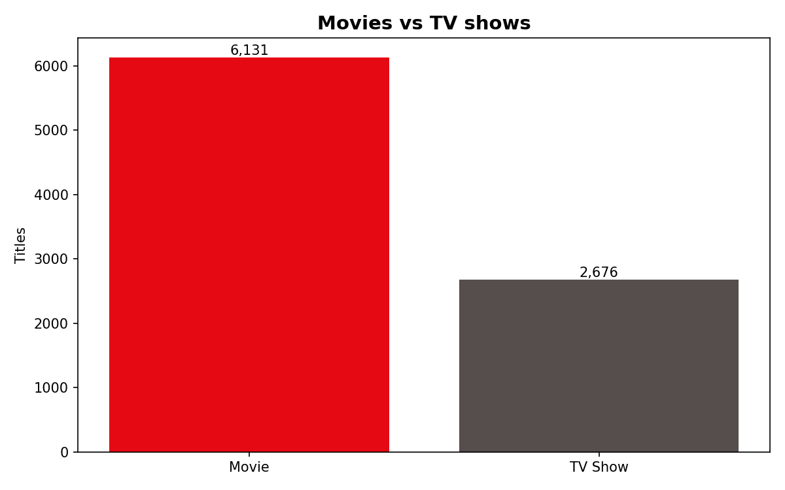
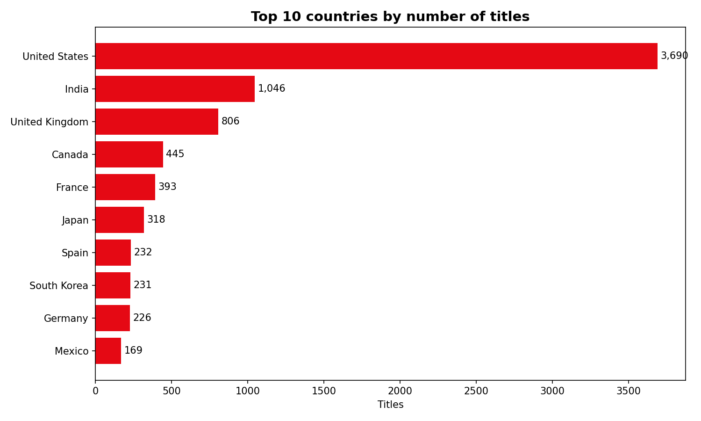
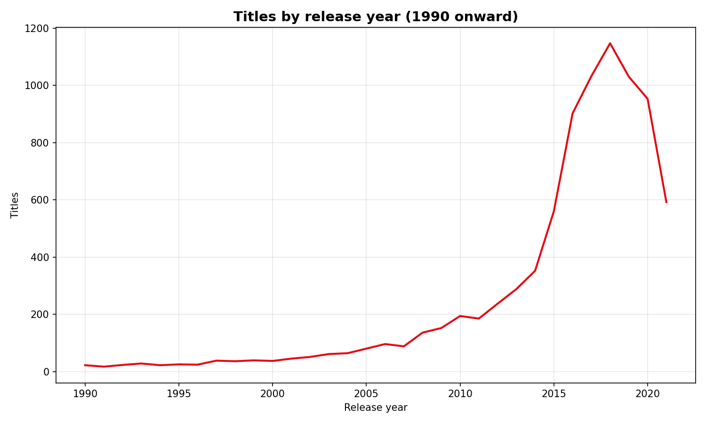

# Netflix Data Analysis

Exploratory analysis of the Netflix titles dataset (`netflix_titles.csv`, 8,807 titles up to 2021) with Python and pandas. It looks at the movie and TV show split, which countries produce the most titles, and how the catalog is spread across release years.

**Live explorer:** https://hassan3443.github.io/netflix-data-analysis/ (filter by type, genre, country, year added and search; all charts update)

## Key findings

All numbers come from `netflix_data_analysis.py` and can be reproduced by running it.

- **Movies make up 69.6% of the catalog.** 6,131 movies and 2,676 TV shows.
- **The United States leads by a wide margin** with 3,690 titles, then India (1,046), the United Kingdom (806), Canada (445) and France (393).
- **Most titles are recent.** 70.6% were released in 2015 or later. Titles per release year rose from 352 in 2014 to a peak of 1,147 in 2018, then fell to 592 in 2021 (the dataset ends in 2021, so the last year is partial).

- **Most titles were added in 2019** (2,016 additions, based on `date_added`), and 98.4% of all dated additions are from 2016 onward. 2021 is a partial year (1,498).
- **The most common genre tags** are International Movies (2,752), Dramas (2,427) and Comedies (1,674). A title can have several tags.
- **Movies have a median length of 98 minutes** (mean 99.6, range 3 to 312).
- **67.0% of TV shows have one season** (1,793 of 2,676).
- **TV-MA is the most common rating**, on 3,207 of 8,800 rated titles (36.4%).

## Charts

| Movies vs TV shows | Top 10 countries |
|---|---|
|  |  |



## Method and caveats

- A title can list several countries. Each country gets one count per title, so country totals add up to more than the number of titles.
- 831 titles (9.4%) have no country listed. They are left out of the country ranking and kept in the other charts.
- The release-year chart starts at 1990 so recent years are readable. The dataset goes back to 1925.
- Three rows had the duration stored in the `rating` column and an empty `duration`. `netflix_lib.py` moves it back, so those titles are counted with the right duration.
- The dataset has no duplicate `show_id` values. `director`, `cast` and `country` have the most missing values.

## Project structure

```
netflix_titles.csv           Dataset (8,807 rows)
netflix_data_analysis.py     Analysis, writes charts to figures/
netflix_lib.py               Cleaning and aggregation functions (tested)
build_site_data.py           Writes docs/data.json and docs/summary.json
docs/                        Live explorer (static HTML, CSS, JS) served by GitHub Pages
tests/test_lib.py            pytest tests for netflix_lib.py
figures/                     Generated charts
requirements.txt             pandas, matplotlib
```

## How to run

```bash
pip install -r requirements.txt
python netflix_data_analysis.py      # charts and printed numbers
python build_site_data.py            # rebuild docs/data.json for the explorer
pip install -r requirements-dev.txt && pytest
```

To open the explorer locally: `python -m http.server --directory docs` and visit http://localhost:8000.

## Tools

Python, pandas, Matplotlib, pytest, GitHub Actions, and plain HTML/CSS/JavaScript for the explorer.

## Author

Hassan Ashraf. [Portfolio](https://hassan3443.github.io/) | [LinkedIn](https://www.linkedin.com/in/hassan1000/)
